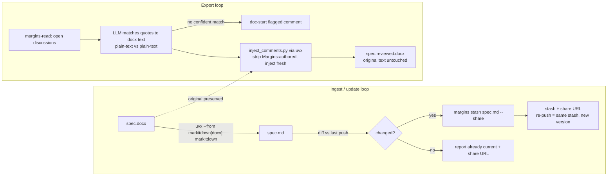
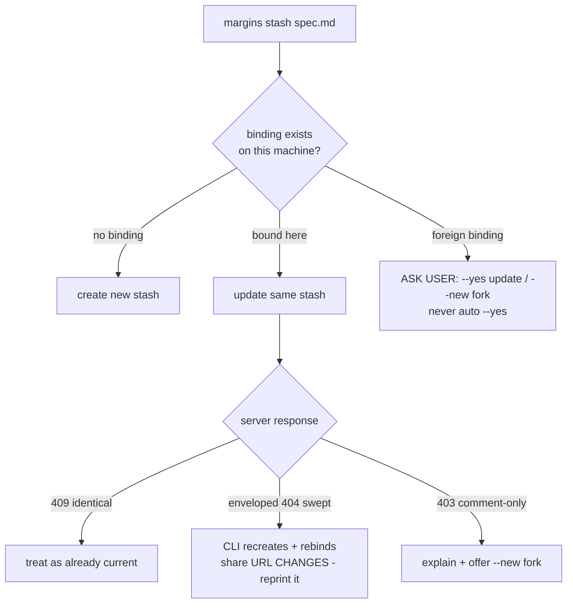

# feat: margins-docx skill — Word doc off-ramp via uvx toolchain

**Target repo:** margins-plugins (this repo). One cross-references margins-cli behavior; no server, CLI, or ai-review changes.

---

## Summary

Add a `margins-docx` skill to the `margins` plugin: convert a .docx to markdown via `uvx --from "markitdown[docx]" markitdown`, publish and update it as a Margins stash through the `margins` CLI, and export Margins discussions back into the untouched original .docx as native Word comments via a bundled `uvx --with python-docx` script. Ships with pytest fixture tests for the injector, a CI step to run them, a consistency fix to the stale margins-stash update claim, and the plugin 0.9.0 release.

## Problem Frame

PMs author specs in Word and review by emailing .docx copies; comments and versions ping-pong through inboxes. Margins has the review layer (stash, share links, text-anchored threads that survive versions) but no Word entry or exit. The agent-first design (origin below) settled that v1 lives entirely in the skill layer: the CLI and MCP surfaces already cover publish/update/read, so the only missing pieces are conversion, comment export, and the skill that orchestrates them. Everything runs through `uvx` — nothing to install beyond uv.

Origin: the approved design doc and two-pass eng review at `~/.gstack/projects/alvistar-ai-review/avigano-main-design-20260714-150737-word-doc-offramp.md` (Alessandro's machine; carries the full decision history — agent-first pivot, archived server plan, outside-voice dispositions).

---

## Requirements

### Ingest & publish

- R1. A user pointing the skill at a .docx gets a readable markdown stash (headings, lists, tables intact; images replaced with visible placeholders) and a share URL, with no tool installation beyond uv and Node.
- R2. Re-running the skill on the same document updates the SAME stash (new version, discussions re-anchor server-side) rather than forking a new one; the share URL is re-printed from CLI output every publish.
- R3. Conversion failures (legacy .doc, encrypted, corrupt, oversized) surface as plain-language guidance, never raw tracebacks.

### Export

- R4. "Export comments" produces a copy of the ORIGINAL .docx with open Margins discussions injected as native Word comments: author-tagged as Margins-injected, anchored to the discussed text, whole thread per comment.
- R5. Export is idempotent — previously injected Margins comments are stripped before re-injecting, so repeated exports never duplicate.
- R6. Comments whose text cannot be confidently located are injected as flagged document-start comments, never silently misplaced; the document's own text is never modified.

### Quality & release

- R7. The injector script has pytest fixture tests (run via uvx) covering anchoring, tagging, idempotency, the text-unchanged invariant, and the unmatched-anchor path — wired into CI.
- R8. The `margins` plugin releases as 0.9.0 (plugin.json only — marketplace entries carry no version) and the stale "a stash is a fresh doc each time" claim in margins-stash is corrected in the same release.

---

## Key Technical Decisions

- **uvx-only toolchain**: ingest via `uvx --from "markitdown[docx]" markitdown` (the `[docx]` extra is required — bare `uvx markitdown` throws MissingDependencyException on .docx, verified on markitdown 0.1.6), export via `uvx --with python-docx`. Zero-install (R1), one runtime channel, matches the repo's "resolve a binary, shell out" style. A bundled mammoth+turndown fallback stays on paper unless the U1 spike shows MarkItDown mangling real documents.
- **All pushes go through `margins stash`** — never `PUT /api/stash` directly. The CLI's `tryUpdate` already implements the full version-skew and recovery matrix (old-server 405, swept-stash recreate+rebind, comment-only 403, foreign-account 403); reimplementing it in the skill would inherit all five branches (see `docs/solutions/design-patterns/client-feature-detection-405-not-404-across-version-skew.md` in the ai-review repo).
- **Binding trust gate is a user decision**: when `margins stash` refuses a binding not recorded on this machine, the skill surfaces the `--yes` (update) / `--new` (fork) choice to the user. Never blanket-pass `--yes` — the gate is a confused-deputy guard (ai-review `docs/solutions/security-issues/planted-stash-binding-confused-deputy.md`).
- **Diff before push; 409 is success**: byte-identical re-push returns 409 `REVERT_UNSUPPORTED` (content-derived synthetic shas). The skill compares against the last-pushed markdown and skips unchanged pushes; a 409 that slips through reads as "already current," not failure.
- **Injector contract**: JSON on stdin (comments with resolved anchor text, context, author, thread body), input .docx path, output path. The LLM does the quote→document matching (quotes are rendered plain text; docx paragraph text is plain — match plain-vs-plain, never against raw markdown syntax); the script does deterministic injection at the resolved positions. `w:author` = "Margins Review" so strip-before-reinject can identify its own comments.
- **`${CLAUDE_PLUGIN_ROOT}` for bundled paths**: this is the repo's first bundled asset; nothing may assume cwd.
- **Release mechanics**: `plugins/margins/.claude-plugin/plugin.json` is the sole version authority; the marketplace lint fails any `version` field on marketplace entries. One commit = the release; no CHANGELOG exists in this repo.

---

## High-Level Technical Design

Two loops share the stash binding; the original .docx never leaves the user's disk.



Publish decision gate (the branches the skill must narrate, all delivered by the CLI):



## Output Structure

```
plugins/margins/skills/margins-docx/
├── SKILL.md                      # ingest + update + export workflows
├── scripts/
│   └── inject_comments.py        # docx comment injector (python-docx)
└── tests/
    ├── test_inject_comments.py   # pytest fixture suite
    └── fixtures/
        └── sample.docx           # tiny committed fixture (everything here ships to installers)
```

Existing files modified: `plugins/margins/skills/margins-stash/SKILL.md`, `plugins/margins/.claude-plugin/plugin.json`, `.github/workflows/lint-marketplace.yml`.

---

## Implementation Units

### U1. Spike: real document through the toolchain

**Goal:** Validate the two risk concentrations on a real PM document before hardening anything: MarkItDown's docx→md fidelity, and quote→docx text matching.
**Requirements:** de-risks R1, R4.
**Dependencies:** none — first unit, gates the rest.
**Files:** none committed (scratch work).
**Approach:** Run one real Pietro .docx through `uvx --from "markitdown[docx]" markitdown`; eyeball headings, lists, tables, image handling. Then probe comment anchoring: pick 3-5 real phrases, locate them in the docx via a throwaway python-docx script (paragraph-text concatenation, run mapping), count confident vs ambiguous matches. Output is a go/no-go on MarkItDown (fallback: bundle a mammoth+turndown script — build only if this fails) and calibration for how much run-splitting the injector must handle.
**Test scenarios:** Test expectation: none — this is a validation spike; its findings shape U3.
**Verification:** A written note (in the PR description or plan margin) recording converter verdict and match-rate on the real document.

### U2. margins-docx skill: ingest and update workflow

**Goal:** The SKILL.md sections that take a user from "here's a Word doc" to a shared, updatable stash.
**Requirements:** R1, R2, R3.
**Dependencies:** U1 (converter verdict).
**Files:** `plugins/margins/skills/margins-docx/SKILL.md` (new).
**Approach:** Follow the margins-stash house style: two-field frontmatter (`name`, block-scalar `description` with "Use when the user wants to:" triggers — "review this Word doc on Margins", "/margins-docx", "put this docx up for comments" — and cross-references to `/margins-read` and `/margins-stash`); copy the binary-resolution + `MARGINS_CONFIG_DIR` preamble verbatim; add a `command -v uvx` check with a plain-language uv install pointer. Convert next to the original (`spec.docx` → `spec.md`) so the CLI's file binding keys updates to the same stash. Narrate the publish decision gate (HTD diagram 2): surface the trust-gate choice, treat 409-identical as already-current, re-print the share URL from CLI stdout every run, note that a swept stash means a NEW share URL. Include the house "Images" section: what survives the round trip (text, headings, tables) and what doesn't (images become placeholders, tracked changes and existing Word comments are dropped on import). Version-gate on `$MARGINS stash --help` per the established pattern, naming the minimum margins-cli version the skill assumes.
**Patterns to follow:** `plugins/margins/skills/margins-stash/SKILL.md` (structure, tone, error paths), `plugins/margins/skills/margins-read/SKILL.md` (discussion vocabulary).
**Test scenarios:** Test expectation: none — skill markdown is agent instructions; behavior is exercised by the U1 spike and the pilot. The deterministic components it invokes are tested in U4.
**Verification:** A real .docx goes end-to-end on a fresh machine profile (no prior binding): convert → stash → share URL printed; editing the .docx and re-running updates the same stash and re-prints the URL.

### U3. Comment injector script

**Goal:** The deterministic half of export: `inject_comments.py`, run via `uvx --with python-docx`.
**Requirements:** R4, R5, R6.
**Dependencies:** U1 (run-splitting calibration).
**Files:** `plugins/margins/skills/margins-docx/scripts/inject_comments.py` (new).
**Approach:** Contract per KTDs: JSON stdin carrying, per comment, the resolved anchor text (plus before/after context), author display, and rendered thread body; args for input path and output path. The script: copies the original; strips comments whose `w:author` matches the Margins tag; locates each anchor by concatenated-paragraph-text search with run-offset mapping (splitting runs as needed — python-docx ≥1.2 `add_comment` anchors on run boundaries); injects unmatched/ambiguous entries as flagged comments anchored at document start with a "position uncertain" prefix; never rewrites run text. Exit non-zero with a machine-readable stderr line on structural failures (missing file, invalid JSON, unreadable docx) so the skill can surface clean guidance.
**Execution note:** Build fixture-first — U4's tests and this script land together; the text-unchanged invariant is the contract, write its test before the injection logic.
**Test scenarios:** enumerated in U4 (the suite is the unit's spec).
**Verification:** U4 suite green via `uvx --with python-docx --with pytest pytest plugins/margins/skills/margins-docx/tests`; a manually exported real document opens clean in Word with comments in place.

### U4. Injector fixture tests + CI wiring

**Goal:** The injector's contracts are enforced in CI, not just at the pilot.
**Requirements:** R7.
**Dependencies:** U3 (developed together).
**Files:** `plugins/margins/skills/margins-docx/tests/test_inject_comments.py` (new), `plugins/margins/skills/margins-docx/tests/fixtures/sample.docx` (new, kept tiny — the skill directory ships to every installer), `.github/workflows/lint-marketplace.yml` (modify: add setup-uv + pytest step; leave the existing lint and node --test steps untouched).
**Approach:** Mirror the repo's test taxonomy from `scripts/check-marketplace.test.mjs` ("happy path: …", "error path: …", "edge: …" naming). Assertions inspect the output zip directly (unzip `word/comments.xml` / `word/document.xml`) rather than trusting python-docx to read back its own writes.
**Test scenarios:**
  - Happy path: one comment with an exact-match anchor lands on the quoted text; `w:author` carries the Margins tag.
  - Happy path: multi-message thread renders as one comment containing the thread body with per-message authors.
  - Happy path: two comments on different paragraphs both anchor correctly.
  - Edge: anchor text split across formatting runs mid-word still anchors (run-splitting).
  - Edge: empty comments list produces a valid copy with zero Margins comments (and strips stale ones).
  - Edge: idempotency — running injection twice on the same input yields identical comment sets, no duplicates (R5).
  - Edge: document text extracted from `word/document.xml` is identical before and after injection (R6 invariant).
  - Error path: unmatched anchor becomes a flagged document-start comment, exit code still success.
  - Error path: missing input file / malformed JSON exits non-zero with the machine-readable stderr line.
  - Error path: a non-docx input (renamed zip / not a zip) exits non-zero cleanly.
**Verification:** CI run on the PR shows the new step green; deleting the strip logic locally makes the idempotency test fail (test actually bites).

### U5. margins-docx skill: export workflow

**Goal:** The SKILL.md sections that take open discussions back into the original .docx.
**Requirements:** R4, R5, R6.
**Dependencies:** U2 (skill file exists), U3 (script contract).
**Files:** `plugins/margins/skills/margins-docx/SKILL.md` (extend).
**Approach:** Fetch open discussions the same way `/margins-read` does (reuse its command shapes and vocabulary — Discussion, Text anchor, orphaned). Instruct the agent to match each quote against the ORIGINAL document's plain text — quotes are rendered plain text; never match against raw markdown syntax — using the anchor's before/after context and nearest heading to disambiguate, and to mark anything below confident as uncertain (the script flags it at document start). Invoke the injector via `uvx --with python-docx python3 "${CLAUDE_PLUGIN_ROOT}/skills/margins-docx/scripts/inject_comments.py"` — never a cwd-relative path. Output lands next to the original as `<name>.reviewed.docx`; the original is never overwritten. Include the export limitations note: comment state edited in Word does not flow back; Margins remains the source of truth for discussion state.
**Patterns to follow:** `plugins/margins/skills/margins-read/SKILL.md` (discussion fetching and formatting).
**Test scenarios:** Test expectation: none — agent-instruction markdown; the deterministic component is covered by U4, and the LLM-matching quality is what the U1 spike calibrated and the pilot measures.
**Verification:** End-to-end on the pilot document: comment in Margins → export → comment visible in Word on the right text; second export produces no duplicates.

### U6. margins-stash consistency fix + 0.9.0 release

**Goal:** The plugin ships with no internal contradictions and Claude Code picks up the new skill.
**Requirements:** R8.
**Dependencies:** U2-U5 complete.
**Files:** `plugins/margins/skills/margins-stash/SKILL.md` (modify step 3: replace the stale "re-running stash creates a fresh doc each time" claim with the current binding-update behavior, reusing the version-gating note pattern), `plugins/margins/.claude-plugin/plugin.json` (0.8.0 → 0.9.0).
**Approach:** One release commit in the established shape (`feat(margins): add margins-docx skill (…)`, body ending "Bumps the margins plugin to 0.9.0 so Claude Code picks up the new skill"). Do NOT add a `version` to the marketplace entry (lint-enforced) and do not touch margins-cowork's 0.1.2. After the plugin updates on a machine with multi-project installs, verify the skill is visible in a second project — the installed_plugins.json first-entry-wins bug silently loads stale versions (workaround documented in the operator's global CLAUDE.md).
**Test scenarios:** Test expectation: none — release mechanics; the marketplace lint and CI run are the checks.
**Verification:** `node scripts/check-marketplace.mjs` passes; after merge + plugin update, `/margins-docx` appears in at least two different projects.

---

## Scope Boundaries

**In scope:** everything above, entirely in margins-plugins.

**Not in scope (true non-goals):**
- Server or CLI changes of any kind — the eng review verified zero server diff (stash update via MCP/CLI already shipped).
- A margins-cowork counterpart skill — Cowork's sandbox cannot upload binary bytes and Claude Desktop users get the flow via the MCP connector without any skill.
- Pietro-side deliverables — his onboarding (Margins invitation + Claude Desktop connector run) is pilot activity, not plan work; the connector doc already exists in the ai-review repo.

### Deferred to Follow-Up Work

- Word-comment import on ingest (existing comments in an uploaded .docx become Margins discussions) — captured in ai-review `TODOS.md`.
- Server-side self-serve upload/export — archived, evidence-gated plan in ai-review `TODOS.md`; build only when a non-agent user needs it.
- mammoth+turndown fallback converter script — build only if the U1 spike fails MarkItDown on real documents.

---

## Risks & Dependencies

- **MarkItDown fidelity on real PM documents** is unvalidated until U1 — that's why the spike gates the plan. Mitigation: fallback converter stays specified but unbuilt.
- **CLI version skew**: the skill resolves whatever `margins` binary is present; binding updates and `--share` need a recent margins-cli. Mitigated by the version-gating pattern plus naming the minimum version in the skill.
- **Fixture payload weight**: everything under the skill directory ships to every installer; fixtures must stay tiny (single-page .docx).
- **First bundled asset**: `${CLAUDE_PLUGIN_ROOT}` resolution is assumed available in plugin skills; if a host doesn't set it, the export step fails visibly — acceptable, but the skill should name the variable in its error guidance.
- **Anchor-match quality** is LLM-dependent by design; the uncertain-anchor flagging (R6) is the floor that keeps failures visible rather than silent.

---

## Sources & Research

- Origin design + two-pass eng review: `~/.gstack/projects/alvistar-ai-review/avigano-main-design-20260714-150737-word-doc-offramp.md` (decision history: agent-first pivot, uvx toolchain, archived server plan).
- Repo conventions: `plugins/margins/skills/margins-stash/SKILL.md` (house style), `scripts/check-marketplace.mjs` + `.test.mjs` (lint + test taxonomy), `.github/workflows/lint-marketplace.yml` (CI shape), commit `92709cd` (release-commit precedent).
- ai-review institutional learnings that shaped KTDs: `docs/solutions/design-patterns/client-feature-detection-405-not-404-across-version-skew.md` (drive updates through the CLI), `docs/solutions/security-issues/planted-stash-binding-confused-deputy.md` (trust gate is a user decision), `docs/solutions/logic-errors/stash-revert-to-ancestor-synthetic-sha-collision.md` (diff-before-push, 409 semantics), `docs/solutions/logic-errors/heading-anchor-rendered-text-vs-raw-markdown.md` (plain-text matching), `docs/solutions/logic-errors/stash-sweep-inactivity-from-last-synced-at.md` + `docs/solutions/security-issues/share-slug-capability-leak-redact-to-boolean.md` (share-URL handling).
- MCP surface confirmation: `margins/src/lib/mcp/tools/send.ts` in ai-review (`update_document` breadcrumb, `list_stash_docs` discovery) — why no server work exists in this plan.

---

## Addendum — 2026-07-15: converter fidelity on code/preformatted blocks

Added after the skill was implemented and reviewed, from hands-on trials publishing a
real N-AND spec (**B3000 Pack 4 Machine Configuration**, written in Gherkin) to Margins.
The U1 spike validated MarkItDown on the Credì doc (prose + ordinary tables) and greenlit
it — but Credì had no code/preformatted content, so the spike missed a whole class the
B3000 doc exposes.

### Finding

The B3000 author encodes each Gherkin feature inside a **single-cell Word table**, with
every Gherkin line a separate paragraph in a **monospace font (Consolas)**. Converters:

- **MarkItDown (shipped):** renders each cell on one line (GFM table cells can't hold line
  breaks), collapsing an entire multi-line feature into one unreadable run-on row.
- **pandoc:** preserves the lines but emits a raw HTML `<table>` with one `<p>` per line —
  won't render as clean markdown on Margins.
- **Docling:** does NOT emit code fences either, but *unwraps* the single-cell tables into
  one-paragraph-per-line (readable, if verbose). Costs: a heavy ML dependency (~100 pkgs,
  slower) and it embeds full base64 images by default (a 9.5 MB output vs MarkItDown's
  lightweight placeholders — needs `--image-export-mode placeholder` to be viable).
- **Custom python-docx pass (prototyped):** detect a single-cell table whose runs are
  predominantly a monospace font → emit a fenced code block, inferring the fence language
  from content (Gherkin/SQL/JSON/…). Produces the best rendering (proper indentation,
  monospace, syntax highlighting for common languages). The clean signal is the **font**,
  not the word `Feature:`.

**No off-the-shelf converter detects code blocks from Word monospace formatting.** Docling
is the closest to *readable* output without custom logic, but it neither produces code
blocks nor stays lightweight.

**Margins-side highlighting:** the reader renders fenced blocks with `rehype-highlight`
(`{ detect: true }`, `render-markdown.ts`) over highlight.js's ~37 common languages. SQL,
JSON, Python, YAML, bash, etc. are coloured automatically. **Gherkin is not in that set**,
so a `gherkin` block renders monospace with lines preserved but no keyword colour. Gherkin
colouring is a one-line **margins-server** change (register the highlight.js `gherkin`
grammar) — out of scope for this plugin.

### Decision

- **Accept MarkItDown as shipped** and document the limitation: code/preformatted content
  authored as monospace single-cell tables (e.g. Gherkin) renders as flattened rows. This
  is a rarely-hit format and not worth carrying converter logic for.
- **Do NOT build the custom monospace→fenced-block converter.** It gives the best output
  but is bespoke logic to maintain for a rare case — explicitly rejected.
- **If code/Gherkin-heavy specs become common,** switch the ingest converter to **Docling**
  with `--image-export-mode placeholder` — a ready-made, no-custom-logic path that yields
  readable (paragraph-unwrapped) output, accepting the heavier dependency. Re-evaluate
  then; don't pre-build.
- **Gherkin syntax colouring** on Margins is a separate, optional server-side task, tracked
  independently of this plugin.

### Scope note

The converter is entirely on the **ingest** side, which the skill currently delegates 100%
to MarkItDown. Any change here (Docling swap, or a rescue pass) touches only the skill's
convert step — no injector, CLI, or server change.
